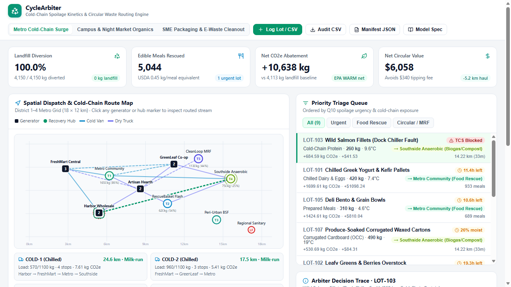

# CycleArbiter

**Cold-Chain Spoilage Kinetics & Circular Waste Stream Routing Engine**  
Built for **Arbiter Hacks V1 — Theme Track: Rethinking Waste**



## Why CycleArbiter?

Over 30% of perishable food is lost between commercial cold docks and retail shelves, while clean corrugated cardboard and rigid plastics routinely get rejected to landfills due to moisture or residue contamination. Store managers and municipal dispatchers still coordinate surplus pickups manually—without knowing which cold-chain lot will breach food-safety thresholds within hours, or which downstream facility still has chilled capacity.

**CycleArbiter** is a **100% client-side, zero-server-cost ($0) operational decision engine** that arbitrates every surplus and commercial waste stream across the **EPA Food Recovery & Circular Economy Hierarchy**:

1. **Q10 Thermal Decay Kinetics & FDA TCS Safety Gate (`src/engine/spoilage.ts`):**  
   Computes temperature-accelerated biological aging (`rate(T) = Q10^((T_eff - T_ref)/10)`) factoring in packaging insulation and cumulative dock excursion hours. High-risk cold-chain items (dairy, seafood/meat, prepared meals) exceeding the FDA 4-hour danger-zone rule are hard-blocked from human donation and automatically rerouted to anaerobic biogas/feed recovery.
2. **Moisture & Contamination MRF Protection (`src/engine/router.ts`):**  
   Guards clean recycling facilities (Optical MRFs) against wet or food-soiled fiber/plastics. For example, rain-damaged cardboard (`>14%` moisture) is automatically redirected to anaerobic fiber pulping/compost rather than contaminating an entire clean baled OCC load.
3. **Capacity-Aware Multi-Objective Arbitrage (`src/engine/router.ts`):**  
   Allocates scarce chilled food bank capacity to the highest-urgency edible lots first, cascading cleanly into flash-sale kitchens, livestock/BSF feed mills, anaerobic digesters, or R2v3 e-waste refurbishers across 4 selectable optimization policies (`Balanced Arbiter`, `Max Meals`, `Max CO2e`, `Min Cost`).
4. **Precedence-Constrained 2-Opt Fleet Dispatch (`src/engine/dispatch.ts`):**  
   Separates refrigerated vans from ambient dry trucks, enforces payload limits, and optimizes pickup-before-dropoff milk-runs with urban road tortuosity (`1.28×` Euclidean), reducing vehicle kilometers and diesel emissions.
5. **Real CSV Intake & Audit Ledger Export (`src/engine/io.ts`):**  
   Upload or paste real commercial manifest CSVs, test heatwave stress (`+0°C` to `+12°C`) and contamination gates live in `<5 ms`, and export **Audit CSV** and **Dispatch Manifest JSON** reports.

## Tech Stack

- **Frontend:** React 19, TypeScript 5.7 (strict mode), Vite 6, Lucide Icons, custom SVG geospatial dispatch & thermal curve visualizations
- **Algorithmic Core:** Pure deterministic TypeScript (`src/engine/`) with zero paid API keys or external backend dependencies
- **Testing:** Vitest unit & integration suite (`src/engine/__tests__/engine.test.ts`) + headless Microsoft Edge CDP E2E verification (`scripts/e2e_edge.mjs`)

## Local Development & Verification

```bash
npm install
npx tsc --noEmit
npm test
npm run build
npm run preview
```

## License

MIT
